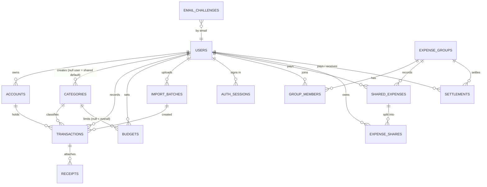

# Personal Expense & Receipt Analytics Tracker — Backend

Spring Boot 4 (Java 21+) REST API with PostgreSQL. It handles passwordless email sign-in, a transaction ledger, CSV and text-PDF import with duplicate detection, budgets, a month-end forecast, and shared group expenses with settlement suggestions.

- Base URL: `http://localhost:8080/api`
- Swagger UI: `http://localhost:8080/swagger-ui.html`
- All money values are **whole RWF** (integers). Other currencies are stored separately and are never mixed into the same total.
- Every ID (users, transactions, categories, groups, members, …) is a **UUID** string.
- Deployment (Docker, staging and production pipeline, rollback) is covered step by step in **[DEPLOYMENT.md](DEPLOYMENT.md)**.

**Quickest start:** `docker compose -f compose.dev.yml up --build`. This starts Postgres, the API with demo data, and an email inbox at http://localhost:8025 where sign-in codes arrive.

## Setup

1. Start PostgreSQL and create the database:
   ```bash
   createdb -U postgres ExpenseTrackerSystem
   ```
   Connection settings are in `src/main/resources/application.properties` (default `postgres`/`postgres` on `localhost:5432`). Hibernate creates the schema on startup (`ddl-auto=update`).
2. Run the API:
   ```bash
   sh mvnw spring-boot:run                                        # normal (emails codes via SMTP_* env vars)
   sh mvnw spring-boot:run -Dspring-boot.run.profiles=demo        # demo data + codes printed to the console
   ```
3. Run the tests. They use a separate `ExpenseTrackerSystem_test` database, rebuilt on every run:
   ```bash
   createdb -U postgres ExpenseTrackerSystem_test   # once
   sh mvnw test
   ```

| Variable | Purpose | Default |
|---|---|---|
| `SMTP_HOST`, `SMTP_PORT`, `SMTP_USERNAME`, `SMTP_PASSWORD`, `SMTP_FROM` | Email delivery for sign-in codes | `localhost:587` |
| `DB_URL`, `DB_USERNAME`, `DB_PASSWORD` | PostgreSQL connection | `jdbc:postgresql://localhost:5432/ExpenseTrackerSystem`, `postgres`/`postgres` |
| `CORS_ALLOWED_ORIGINS` | Comma-separated browser origins allowed to call `/api/**` | `http://localhost:5173,http://127.0.0.1:5173` |
| `JWT_SECRET` | HS256 key that signs access and refresh tokens (at least 32 bytes; `openssl rand -base64 48`) | dev-only value; **required** in staging/prod |
| `SPRING_PROFILES_ACTIVE` | `dev`, `demo`, `staging` or `prod`. The `staging` and `prod` profiles have **no defaults** for the variables above, so a missing value stops startup | none |

See `.env.example`, `deploy/env.staging.example` and `deploy/env.production.example`.

> **Never enable the `demo` profile in production.** It sets `app.auth.log-codes=true`, which writes sign-in codes to the log so anyone with log access can sign in as any user.

## Demo data (`demo` profile)

On first start, the `demo` profile creates:

| User | Data |
|---|---|
| `amina@demo.local` (Amina Uwase) | Salary, rent, groceries, transport and data transactions this month; a 60,000 food budget and a 250,000 overall budget; owner of the **Kigali Flatmates** group |
| `jean@demo.local` (Jean Habimana) | Salary and groceries this month; group member |
| `eric@demo.local` (Eric Mugabo) | Group member |

All three demo accounts also sign in with `POST /api/auth/login` using the password `Demo12345`.

Kigali Flatmates holds one bill: **Dinner, RWF 30,000, paid by Amina, split equally**. Balances are Amina +20,000, Jean −10,000 and Eric −10,000. Seeding runs once; if Amina already exists, nothing is changed.

Shared categories (Food & Groceries, Transport, Rent & Housing, Utilities, Airtime & Data, Health, Education, Entertainment, Shopping, Other; Salary, Business, Gifts, Other Income) are seeded on **every** start, in every profile, so a fresh database can record transactions immediately.

## Live demo script

Use Swagger UI, or the commands below (`$T` is the access token).

1. **Sign in.** Either `POST /api/auth/login {"email":"amina@demo.local","password":"Demo12345"}`, or request a code with `POST /api/auth/otp/request` and verify it with `POST /api/auth/otp/verify`. Paste the `accessToken` into **Authorize**. Paste it into jwt.io to show the claims.
2. **Dashboard.** `GET /api/dashboard` shows income, expenses, net, category totals, budget warnings, and the forecast with its explanation.
3. **Import a CSV.**
   ```bash
   curl -H "Authorization: Bearer $T" -F file=@samples/statement-october-2026.csv \
        http://localhost:8080/api/imports/preview
   ```
   Correct any rows, then send them to `POST /api/imports/confirm`. **Repeat both steps:** every row in the second preview is flagged `"Already in your transactions"`, and the confirm call returns `importedCount: 0`.
4. **Import a PDF.** Upload `samples/statement-november-2026.pdf` (5 statement lines; balances are ignored) or `samples/receipt-simba.pdf` (one row taken from the TOTAL line). A scanned PDF or a photo is rejected with **415** and an explanation.
5. **Settle up.** `GET /api/groups` → `GET /api/groups/{id}/balances` → `GET /api/groups/{id}/settlements/suggestions` returns two transfers of 10,000 to Amina. Record each with `POST /api/groups/{id}/settlements`; the balances then read 0 / 0 / 0.

## API overview

| Area | Endpoints |
|---|---|
| Auth (public) | `POST /auth/otp/request`, `POST /auth/otp/verify` (first time also takes `fullName`, `password`, `role`), `POST /auth/login {email, password}`, `POST /auth/refresh {refreshToken}` |
| Auth (signed in) | `GET /auth/me`, `PUT /auth/me {fullName}`, `POST /auth/logout` (this session), `POST /auth/logout-all` (every device) |
| Health (public) | `GET /actuator/health` |
| Categories | `GET /categories?kind=EXPENSE\|INCOME`, `POST /categories {name, kind}`, `DELETE /categories/{id}` (your own, unused ones only) |
| Transactions | `GET /transactions?from&to&type&currency&categoryId&accountId&recurring`, `POST`, `GET/PUT/DELETE /transactions/{id}`, `POST /transactions/recurring/generate` |
| Import | `POST /imports/preview` (multipart `file`, JSON `{csvContent}`, or `text/plain`), `POST /imports/confirm` |
| Budgets | `GET /budgets?month=YYYY-MM`, `POST /budgets`, `GET/DELETE /budgets/{id}` |
| Dashboard | `GET /dashboard?month=YYYY-MM&currency=RWF` (any signed-in user; always scoped to the caller) |
| Groups | `POST/GET /groups`, `POST/GET /groups/{id}/members`, `POST/GET /groups/{id}/expenses`, `GET /groups/{id}/balances?currency=`, `GET /groups/{id}/settlements/suggestions?currency=`, `POST/GET /groups/{id}/settlements` |

Notes for clients:
- Sign-in responses contain only `{accessToken, refreshToken}`, both signed JWTs. Decode the access token on the client for `sub` (user id), `email`, `name`, `role` and `exp`. Changing a claim breaks the signature, so the server rejects edited tokens.
- The first `otp/verify` for a new email registers the account. `fullName` and `password` are required (8–72 characters, with a letter and a digit, stored as a BCrypt hash). `role` is optional and defaults to `MEMBER`; any role except `ADMIN` can be chosen.
- Send `Authorization: Bearer <accessToken>`. Access tokens last 15 minutes. When a call returns 401, call `/auth/refresh` once; each refresh token works only once. If that also fails, sign in again.
- `categoryId` on a transaction is optional and defaults to **Other** / **Other Income**. The category must match the transaction type.
- CSV columns: `date,amount[,type,merchant,description]`. Dates may be `YYYY-MM-DD`, `DD/MM/YYYY`, or `14 Nov 2026`. Files can be UTF-8 (with or without a BOM), UTF-16 with a BOM, or Windows-1252, which Excel uses by default.
- When a confirm request omits `skipDuplicates`, it defaults to `true`. Set `allowDuplicate: true` on a row to import a genuine repeat.
- Group expenses, balances, suggestions and settlements take a `currency` (default `RWF`). Each currency is settled on its own.

## Forecast formula

```
projectedTotal = round_half_up(spentSoFar / daysElapsed × daysInMonth)
```
The daily average is kept exact (`averageDailySpend` is reported to two decimals), and only the final total is rounded. Example: spending 10,001 by 10 November gives 30,003. Rounding the average down first would give 30,001. `ForecastCalculatorTests` checks the calculation against known figures.

## Entity relationships



Every transaction stores a SHA-256 `fingerprint` of user, date, amount, currency, type, merchant and description. The import preview and confirm steps both check it to find duplicates.

## Tests

| Class | What it proves |
|---|---|
| `BriefOutcomeTests` | Importing the same statement twice adds nothing. Text-PDF import works, and scanned or image uploads get 415. Settling a three-way RWF 30,000 split leaves 0/0/0. Group balances keep currencies apart. A brand-new member can use categories and open a dashboard whose totals reconcile. |
| `ForecastCalculatorTests` | The forecast matches the formula on known figures, including rounding. |
| `ImportParsingTests` | Statement and receipt PDF parsing, charset detection, the bundled sample files, and image rejection. |
| `DemoDataSeederTests` | The demo seed is complete and runs only once (inside a rolled-back transaction). |
| `AuthenticationTests` | OTP single use, attempt limits, token rotation, profile, logout, logout on every device, the public health check, and the Swagger security docs. |
